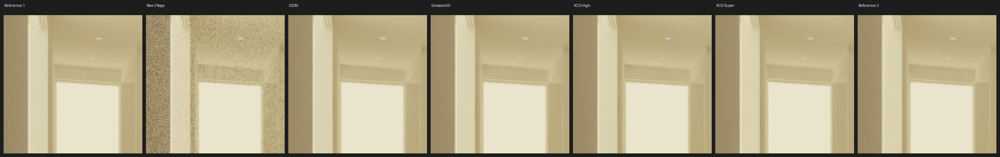
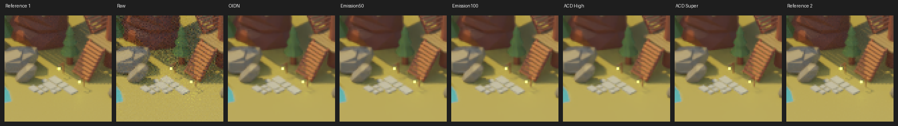
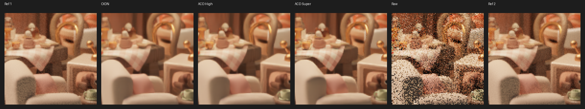
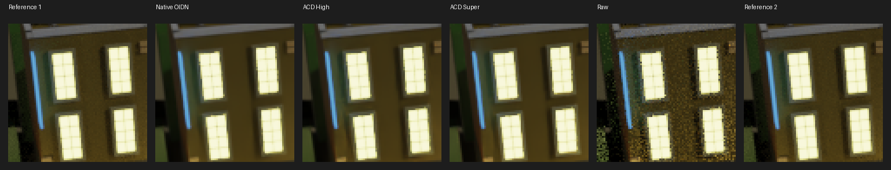
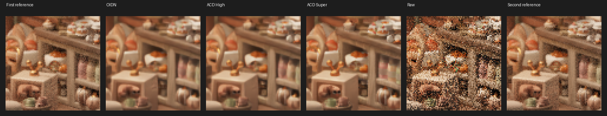

# ACD — Galería de comparaciones reproducibles

Imágenes derivadas de renders reales de Blender/Cycles: las columnas usan **el mismo render ruidoso** dentro de cada experimento y una curva de visualización común. Los recortes son diagnósticos y **no prueban calidad perceptual**. Todas las imágenes están versionadas en Git y, mientras el repositorio exista, no dependen de la caducidad de GitHub Actions.

## Modern Hall — E0033 / E0034, 512×512

[**Abrir galería completa (imagen íntegra y cuatro ROI)**](hall_e0034/README.md) · [Métricas exactas E0033](../../docs/experiments/E0033_RESULTS.json)

Origen Modern Hall © NewSee2l035 (CC BY 3.0), a través de los recursos de Benedikt Bitterli y conversión publicada por cuteday. El .blend convertido **no** está redistribuido. E0033: 3 seeds 24 spp, 2 refs 1024 spp; E0034 contiene imágenes de seed539. Convergencia no acreditada.

## Low-Poly Island — E0029 / E0030, 320×272

[Ver las cuatro comparaciones PNG](island_e0030/)

© Yunus Emre Karaman, MIT. Dos ROI del primer informe se solapan; no contarlas como evidencia independiente. No implica superioridad visual general.

## Cozy Kitchen — E0021, 512×482

[Ver los tres recortes PNG](cozy_e0021/)

Arte de Nicole Morena para Blender 3.5, CC BY-SA (versión no especificada en el catálogo). E0021 incluye 3 seeds y 2 referencias de 1024 spp, sin demostrar convergencia.

## Terraced Houses — E0023, 320 px de ancho

[Ver los tres recortes PNG](terraced_e0023/)

© Yunus Emre Karaman, MIT. Exterior nocturno usado para análisis HDR y Emission AOV; obra distinta de Island pero mismo autor/estilo.

## Cozy Kitchen — E0020, 320 px de ancho (histórico)

[Ver los tres primeros recortes PNG](cozy_e0020/)

Piloto de menor resolución conservado por trazabilidad, no la referencia preferida.

## Dónde se conservan los archivos

- **PNG y JSON resumidos:** directorios de esta galería y docs/experiments; están incorporados a Git y pueden abrirse directamente en GitHub.
- **EXR lineales completos, AOV, salidas individuales y referencias:** artifacts ZIP de los workflows en GitHub Actions. **Caducan** según cada run, habitualmente en 7–14 días; no constituyen almacenamiento permanente.
- **E0033 EXR (Modern Hall):** [artifact 14034252923](https://github.com/mxlzz/ACD/actions/runs/43416607737/artifacts/14034252923), caducidad indicada 2026-11-27. Las métricas exactas y los PNG de E0034 ya están preservados en Git.
- **Escenas .blend:** leer benchmarks/scenes/README.md para procedencia y licencias. No confundir escenas permitidas con escenas privadas; el archivo del usuario Prueba ACD.blend no fue publicado.

Los paneles utilizan una transferencia diagnóstica común para exposición HDR, **no** la transformación OCIO/AgX de Blender. La comparación numérica principal se calcula directamente sobre valores scene-linear, sin esa transformación.
