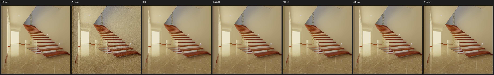
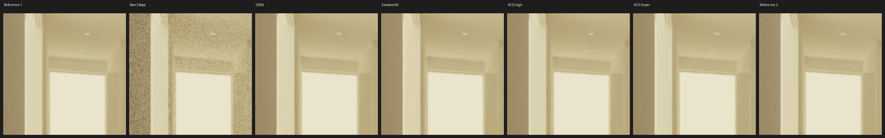
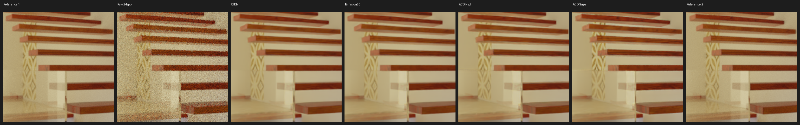
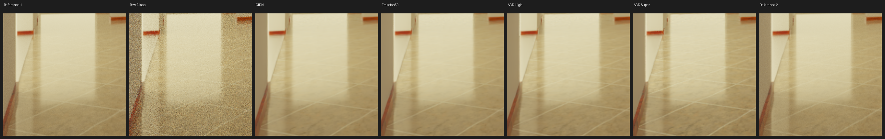
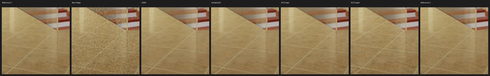

# E0034 — Modern Hall denoiser gallery

From archived E0033 EXRs, no new render. Original source by NewSee2l035 (CC BY 3.0); source conversion by cuteday via Benedikt Bitterli. Original .blend not redistributed.

Columns: Reference 1, Raw 24 spp, OIDN, Emission50, ACD High, ACD Super, Reference 2. Same diagnostic HDR display transform; not Blender OCIO or proof of perceptual quality.

## Entire frame, native pixels

## Brightest ROI, zoom 3x

## detail_1 [192, 192, 128, 128]

## detail_2 [32, 288, 128, 128]

## detail_3 [160, 320, 128, 128]

All crop boxes are selected exclusively from both finite references and are mutually disjoint. Crops show the first 24 spp seed; global table uses three.
Two 1024 spp references are not proven converged; compare bright pixels and halos descriptively. [E0033 numeric JSON](../../../docs/experiments/E0033_RESULTS.json).
