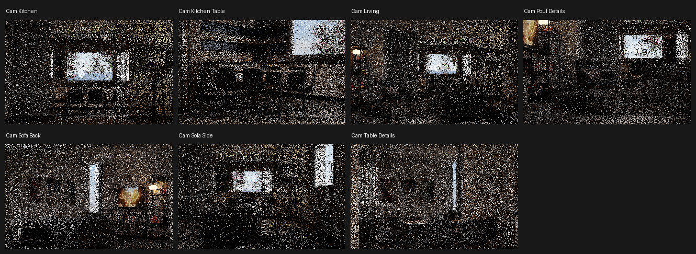
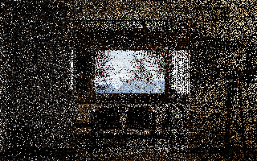
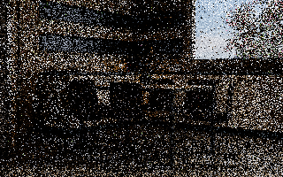
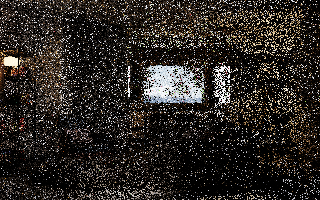
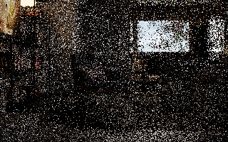
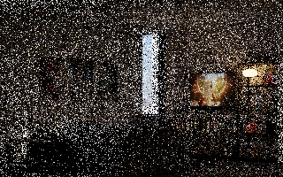
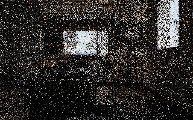
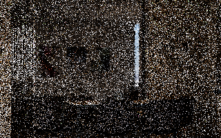

# E0040 — Italian Flat camera previews (4 spp, no denoising)

Source: Flavio Della Tommasa, official Blender Cycles demo, CC-BY (version unspecified). Original source not redistributed.
Blender 5.2.4 LTS, CPU, 320×200 and 4 spp; artist's scene camera choices. Preview images are not denoiser quality evidence.

## Cam Kitchen

4-spp CPU wall time: 27.52 seconds

## Cam Kitchen Table

4-spp CPU wall time: 26.72 seconds

## Cam Living

4-spp CPU wall time: 26.95 seconds

## Cam Pouf Details 

4-spp CPU wall time: 27.22 seconds

## Cam Sofa Back

4-spp CPU wall time: 27.35 seconds

## Cam Sofa Side

4-spp CPU wall time: 27.74 seconds

## Cam Table Details 

4-spp CPU wall time: 27.26 seconds
