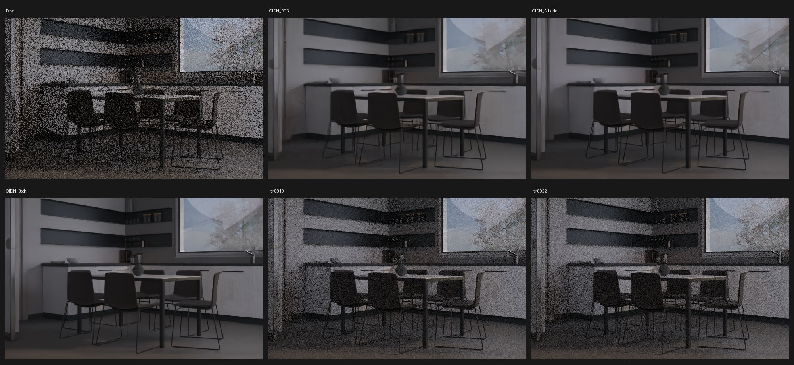

# E0043 — OIDN native guide ablation: diagnostic only

Source: Italian Flat by Flavio Della Tommasa, Blender Cycles CC-BY; scene loaded on Blender 5.2.4 LTS.
**Scene quarantined:** its external IES profile `IES_profiles/three-lobe-vee.ies` was missing in all E0042/E0043 runs; original photometric lighting was not preserved. Comparisons describe these incomplete renders only.
32 spp seed539 on a single Cycles RenderLayer; same noisy RGB with three built-in OIDN modes (RGB, Albedo, Albedo+Normal), High / Accurate / HDR.
Two existing 128 spp references are unconverged, both with the same missing IES. No new denoiser or algorithm tested.

| Candidate | RMSE vs reference8819 | RMSE vs reference8922 |
|---|---:|---:|
| Raw | 0.0917117 | 0.0917064 |
| OIDN_RGB | 0.0435443 | 0.0434836 |
| OIDN_Albedo | 0.0430501 | 0.0429933 |
| OIDN_Both | 0.0423013 | 0.0422805 |

Reference-reference RMSE: 0.055491923813307524.
Reference-screened 4×4 possible guide regressions: []. Screening does not prove perceptual damage.
**Decision gate:** this fixture cannot substantiate an improvement or represent the intended lighting. Do not tune OIDN or integrate ACD from this result. A complete fixture and more reliable references are needed before proposing a new algorithm.
[Exact measurements](../../../docs/experiments/E0043_RESULTS.json).
