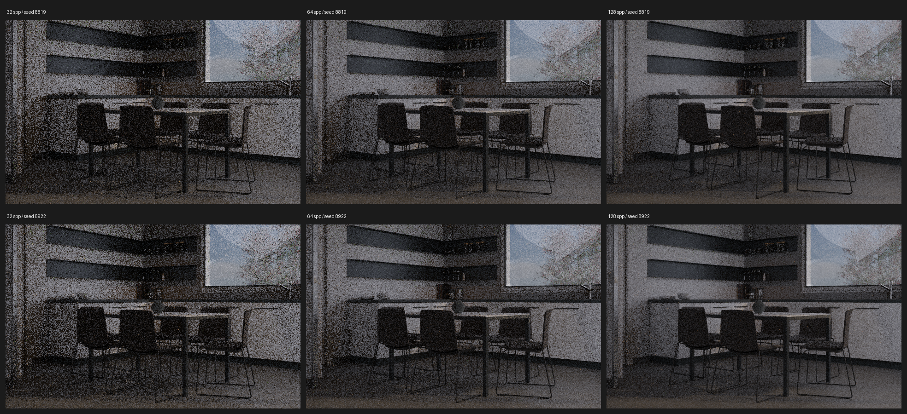

# E0042 — Italian Flat, finite reference spread at 640x400

Six Cycles CPU scene-linear renders, no denoising, Blender 5.2.4 LTS; camera Cam Kitchen Table. Original .blend not published.
Two seeds 8819 and 8922 at 32, 64 and 128 spp each. Source CC-BY © Flavio Della Tommasa.

| Samples | Interseed RMSE |
|---|---:|
| 32 | 0.11710424 |
| 64 | 0.08073157 |
| 128 | 0.05549192 |

Combined actual rendering+write wall seconds: 456.1. Peak process RSS (Linux KB): 11002956.
This comparison evaluates remaining Monte Carlo sample noise, NOT denoising quality. Two finite references are not converged ground truth and may have correlated random streams. Preview transfer not Blender OCIO/AgX.
Analysis JSON: [E0042_RESULTS.json](../../../docs/experiments/E0042_RESULTS.json).
