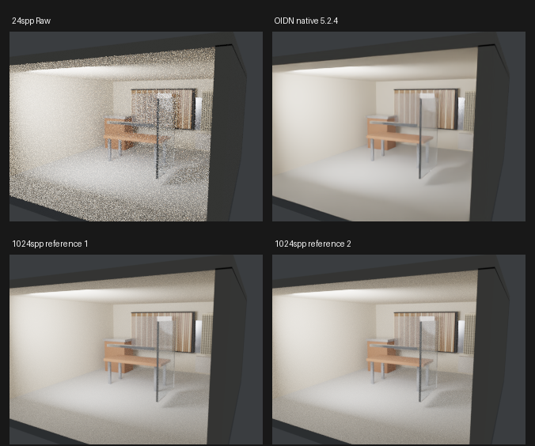

# E0044 — OIDN actual en detalles arquitectónicos procedurales

Blender 5.2.4 LTS, 320x240, 24 spp seed539, 2 refs 1024 spp seeds8819/8922. Sin assets externos, sin nuevos métodos.
El fixture contiene 52 lamas, juntas de azulejos, vidrio, metal y bump procedural. Compositor OIDN High/Accurate/HDR con guías albedo/normal.

| Método | RMSE ref1 | RMSE ref2 | Edge RMSE ref1 | Ratio de contraste de borde ref1 |
|---|---:|---:|---:|---:|
| Raw | 0.22176946 | 0.22134015 | 0.25347908 | 1.87801 |
| NATIVE_COMP_OIDN | 0.05399724 | 0.05348985 | 0.06957210 | 0.68594 |

Referencia contra referencia RMSE: 0.04081857430887757.
Tiles con contraste reducido en ambas referencias (<0.75): [[240, 0, 80, 80], [0, 80, 80, 80], [80, 80, 80, 80], [0, 160, 80, 80], [80, 160, 80, 80], [160, 160, 80, 80], [240, 160, 80, 80]]. La pérdida de contraste por sí sola NO es un fallo confirmado ni una ventaja de otro filtro.
El experimento E0016 (Blender 5.0.1) tiene otros renders de entrada; la diferencia numérica entre ambos experimentos no aísla un cambio de backend OIDN.
Sin convergencia probada ni calidad perceptual certificada. No se promueve ninguna modificación al addon.

[Datos y 12 regiones fijas](E0044_RESULTS.json).
