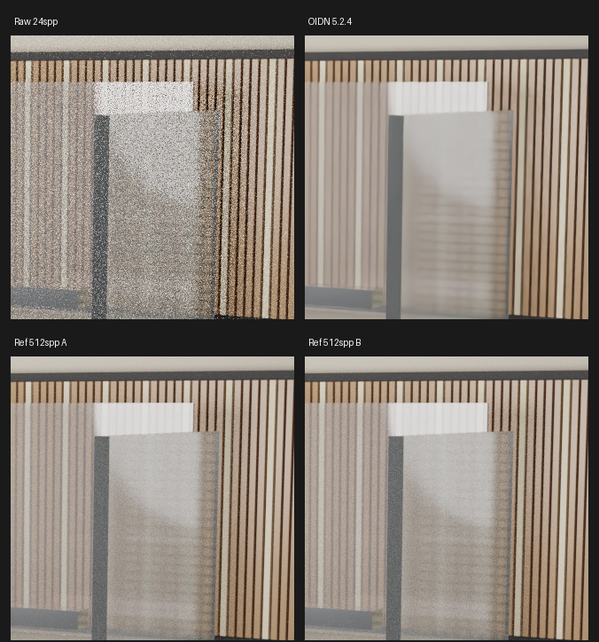

# E0046 — Lamas a escala real de píxel (crop, no frame completo)

Blender 5.2.4 LTS: camera 1920×1440 px, 512×512 px render border, interior evaluado 320×320 (margen 96px). Misma cámara y geometría original.
24 spp seed539 Raw y OIDN compositor High/Accurate/HDR; referencias 512 spp seeds 8819/8922. No hay algoritmo nuevo.

| Método | RMSE ref1 | RMSE ref2 | Error gradientes ref1 | Contraste bordes ref1 |
|---|---:|---:|---:|---:|
| Raw | 0.33988205 | 0.34015330 | 0.34532156 | 1.4700 |
| NATIVE_COMP_OIDN | 0.06840104 | 0.06827452 | 0.10922771 | 0.6655 |

Referencia↔referencia RMSE: 0.07922160379956453.
El período de las lamas es ahora ~8–10 px, frente a 1.3–1.7 px en E0044. La comparación no es causal entre resoluciones: cambian ruido, píxeles y campo de filtro.
El OIDN ve solo el crop: 96 px de margen para reducir artefactos de borde, no para eliminarlos con garantía.
No se demuestra convergencia ni se propone una nueva técnica; cualquier hallazgo visual debe ser explicado y comprobado en otra escena.

[JSON con cuatro regiones interiores](E0046_RESULTS.json).
