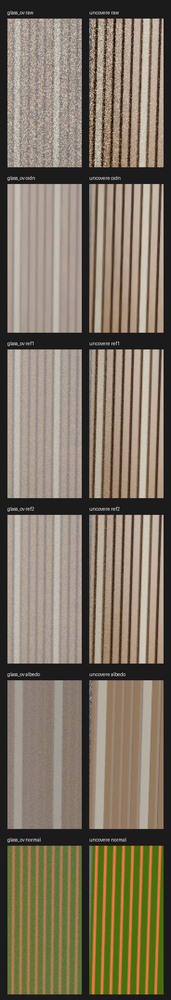

# E0047 — Lamas detrás del vidrio vs lamas sin vidrio (diagnóstico)

Regiones fijadas antes de calcular; extraídas de EXR originales E0046 sin volver a renderizar ni probar nuevos filtros.
Fuente: fixture procedural Blender 5.2.4, crop FOV 1920px, 24spp Raw/OIDN y dos refs512spp.

| Región | Corr. gradiente horizontal refs | Ratio de gradientes OIDN (ref1 / ref2) | RMSE refs |
|---|---:|---|---:|
| glass_overlap | 0.68126 | 0.50099 / 0.50718 | 0.088010 |
| uncovered_slats | 0.95083 | 0.90734 / 0.90602 | 0.065787 |

La zona bajo vidrio y la zona sin vidrio tienen contenido/iluminación diferentes. La correlación y los ratios no demuestran que el vidrio *cause* la diferencia.
El objetivo es localizar un posible patrón que sobreviva en ambos refs y no en OIDN. No se implementó un algoritmo.
Refs finitas 512spp, margenes 96px no excluyen artefactos del procesamiento sobre crop.

[JSON con guías originales, errores por referencia y ROIs](E0047_RESULTS.json).
