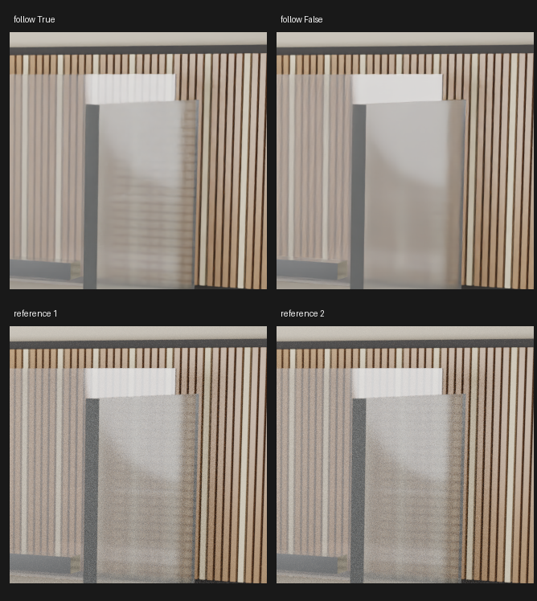

# E0048 — Existing Cycles follow-reflections option: controlled diagnostic

Blender 5.2.4, procedural fine-detail scene, single 24spp new render with follow=False; reused original E0046 follow=True render and both 512spp references.
Same camera at virtual 1920x1440, original crop 512x512 and fixed E0047 glass/direct regions. Not a new algorithm.

Raw maximum channel delta: 0.0. Same noisy input: True.
Guide differences: {'albedo': {'log1p_luminance_rmse': 0.19612407368485985, 'pixel_rmse_p95': 0.5325880925176862, 'mae_linear': 0.13014015296940107, 'rmse_linear': 0.2887678173680421, 'relative_rmse': 0.5324407626358856, 'psnr_db': None, 'psnr_data_range': None, 'exact_match': False}, 'normal': {'log1p_luminance_rmse': 0.0518234420507721, 'pixel_rmse_p95': 0.6701676008509396, 'mae_linear': 0.148502710050426, 'rmse_linear': 0.3274889988900306, 'relative_rmse': 0.6840872437415704, 'psnr_db': None, 'psnr_data_range': None, 'exact_match': False}}.
Decision: DIAGNOSTIC only: native guide setting changed output, inspect against both finite references

| Region | Policy | RMSE ref1 | RMSE ref2 | Contrast ref1 | Contrast ref2 |
|---|---|---:|---:|---:|---:|
| glass_overlap | follow_true | 0.0703999 | 0.0700835 | 0.5010 | 0.5072 |
| glass_overlap | follow_false | 0.0757960 | 0.0752893 | 0.4485 | 0.4544 |
| uncovered_slats | follow_true | 0.0601491 | 0.0602176 | 0.9073 | 0.9060 |
| uncovered_slats | follow_false | 0.0612257 | 0.0614472 | 0.9222 | 0.9210 |
| interior | follow_true | 0.0684010 | 0.0682745 | 0.6655 | 0.6658 |
| interior | follow_false | 0.0774427 | 0.0769845 | 0.6546 | 0.6555 |

Two 512spp references remain nonconverged; no claim of general denoiser improvement. No addon modified.
[Raw numerical results](E0048_RESULTS.json).
