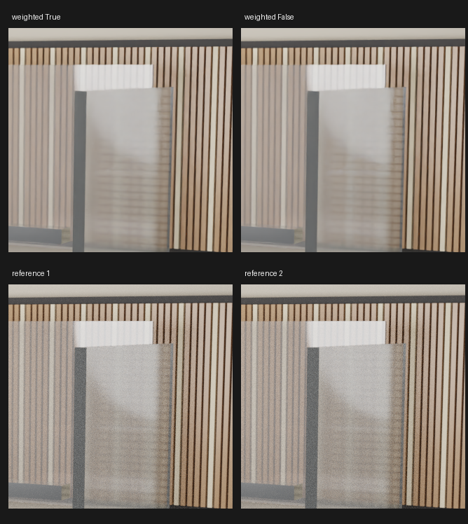

# E0049 — Existing Cycles roughness-weighting option: controlled diagnostic

Blender 5.2.4, procedural fine-detail scene, single 24spp new render with follow=False; reused original E0046 follow=True render and both 512spp references.
Same camera at virtual 1920x1440, original crop 512x512 and fixed E0047 glass/direct regions. Not a new algorithm.

Raw maximum channel delta: 0.07722318172454834. Same noisy input: False.
Guide differences: {}.
Decision: STOP: Raw changed; no same-input causal inference

Two 512spp references remain nonconverged; no claim of general denoiser improvement. No addon modified.
[Raw numerical results](E0049_RESULTS.json).
