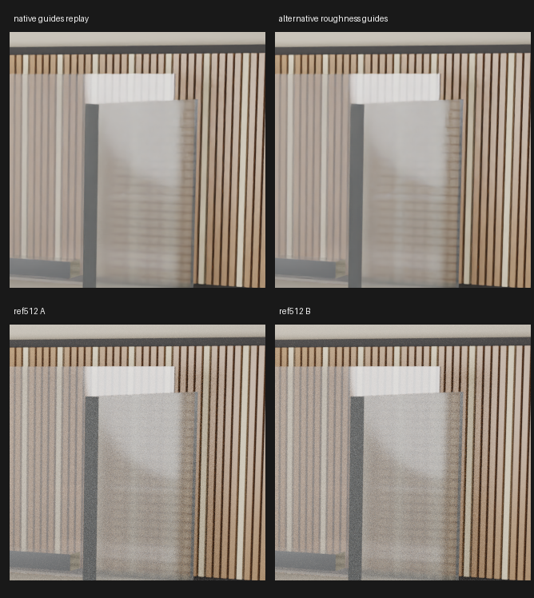

# E0050 — Offline Blender OIDN replay with frozen same Raw and two guide sets

[Prior protocol](E0050_PLAN.md). Source E0046/E0049 EXR/AOV, same input image; original Blender addon untouched. No new architectural reference renders.

Raw passthrough maximum delta: 0.0. Verified=True.
Baseline OIDN native vs replay maximum delta: 0.034577369689941406. Verified=False.
Decision: STOP: offline native-guide replay not equivalent to original compositor
Difference between replayed OIDN outputs RMSE: 0.010646725991827128. This does not imply a quality winner.

Two 512spp refs nonconverged. Only internal guide policy intervention is tested; no novel ACD denoiser.
[Full JSON](E0050_RESULTS.json).
