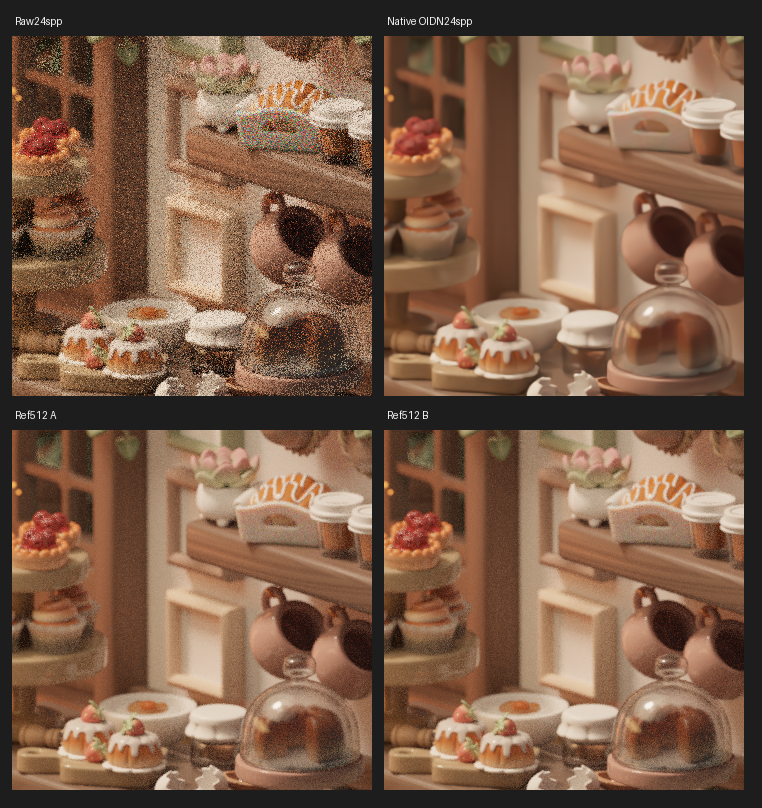

# E0054 — Cozy detail_2 at virtual 1920px: actual OIDN and two finite references

Source: Nicole Morena, Cozy Kitchen CC BY-SA; Blender5.2.4, CPU.
Noisy 24spp ×3 seeds and 512spp ×2 independent reference seeds; true 512² crop at native 1920px camera density, centered 360².
All denoisers use same Raw per seed. No original ACD algorithm tested.

- Wall seconds, including all five Cycles renders and file writes: 699
- Reference1 vs reference2 HDR RMSE (central ROI): 0.077947
- Native OIDN mean HDR RMSE against both finite refs: 0.092270
- Reference disagreement / OIDN error ratio: 0.845; ratio alone is not convergence proof.
- Common-reference edge mask pairs: 18828
- OIDN projected edge gain, 3 noisy seeds: 0.741, 0.753, 0.751
- Pre-registered attenuation screen on center: True.

All ROI and masks derived from two finite references; E0021 detail_2 was already observed, and cannot be heldout. The reference pair can share bias. The crop excludes outer 76px but denoiser receptive-field border effects are not eliminated by proof.
Preview has a shared diagnostic transfer, not Blender OCIO/AgX. The test does not demonstrate an improvement over OIDN or independent generalization.

[Exact hashes and per-seed results](E0054_RESULTS.json).
