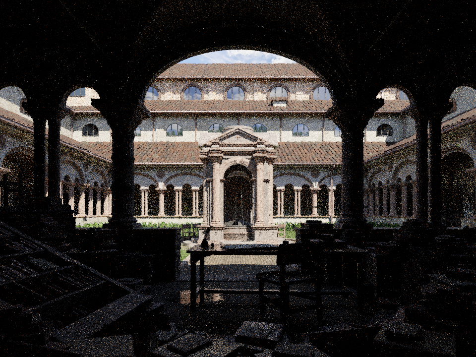

# E0064 — Lone Monk original camera framing and render cost

Carlo Bergonzini / Monorender, CC BY, official Blender Cycles demo. Blender 5.2.4.
Only a source-camera 8spp preview; no denoiser, reference or ACD method tested.

- Source image dimensions: [1440, 1080]; original camera cam.001 unchanged.
- Preview: [960, 720] at 8spp seed 539.
- Cycles render seconds: 16.73.
- Luminance quantiles of display RGB: [0.0, 0.008677, 0.892001].
- Usable framing screen: True.
- SHA256: 22ab1cf8ebfd76078d5bd3f1e84ebe8ac9e812c1797eb1e0216a342cfb1a16b7.

This image only establishes the existence/placement of physically relevant architectural features.
Any ROI must be preregistered on original camera coordinate system BEFORE denoiser output.
This is a development scene, not a blind holdout. Quality ranking is forbidden.

[Provenance and metrics](E0064_RESULTS.json).
