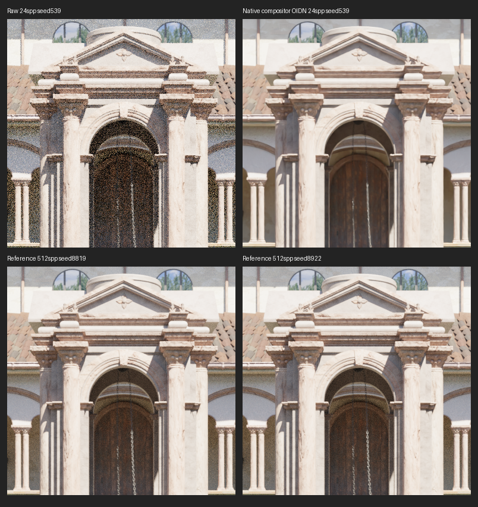

# E0065 — Lone Monk: physically identified stone portal, native OIDN finite-reference residual

Official Blender Cycles demo, Carlo Bergonzini / Monorender CC BY. Blender5.2.4 CPU.
Portal/cornice/columns visible on original-camera E0064 unfiltered 8spp preview; fixed crop at virtual1920x1440 before observing OIDN outputs.
Three independent-seed 24spp noisy RenderLayers share Raw/AOV with OIDN; two 512spp reference renders are finite, NOT certified converged.

- Full 5-render CPU workflow elapsed wall: 617 seconds.
- Same-sample Raw EXR beauty/AOV max absolute: 0.0.
- Standard branch/native compositor OIDN max absolute: 0.0.
- Portal center, reference/reference HDR RMSE: 0.074901.
- Portal center, mean native OIDN vs both finite refs HDR RMSE: 0.163106.
- Ref/reference spread divided by OIDN/reference error: 0.459.
- Reference pair asinh-gradient RMSE: 0.049672.
- Native OIDN mean asinh-gradient RMSE to refs: 0.068731.

| Fixed semantic region | Ref/Ref HDR RMSE | Native/finite-ref RMSE | Relative uncertainty |
|---|---:|---:|---:|
| portal_architecture | 0.074901 | 0.163106 | 0.459 |
| portal_cornice_pediment | 0.079920 | 0.172503 | 0.463 |
| portal_columns_and_arch | 0.071100 | 0.156043 | 0.456 |
| full_crop_including_context | 0.096874 | 0.204543 | 0.474 |

**Interpretation:** These quantify residual and reference uncertainty, not a correctable OIDN-specific bias or ACD win. The source has already been observed; not a holdout. No hand-picked mask from OIDN, no altered native settings, no algorithm.
A positive residual does not imply denoising makes a physical edge worse; noise, finite references, spectral/nonlinear features and renderer variance remain.
Only if the physical detail residual exceeds reference uncertainty convincingly, inspect paired error maps and test against added Cycles spp at equal cost before postprocess research. Otherwise stop the idea.

[Immutable method/metadata/hashes and per-seed metrics](E0065_RESULTS.json).
